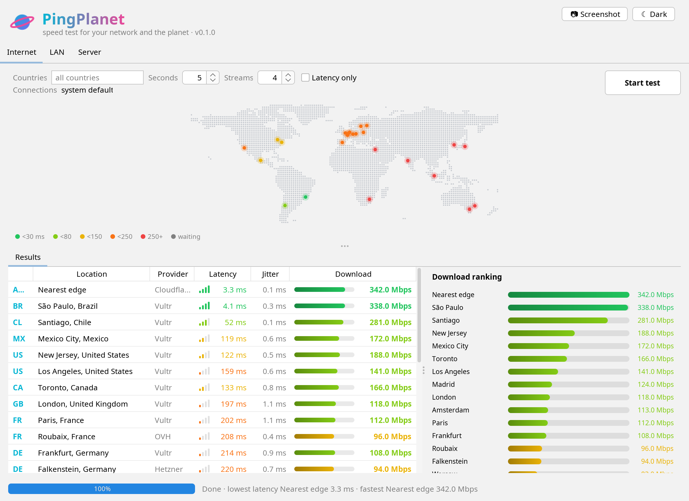

<h1 align="center">PingPlanet</h1>

<p align="center">A speed test for your local network and for servers in 20 countries, written in Java.</p>

<p align="center">
  <a href="https://github.com/boaglio/PingPlanet/actions/workflows/build.yml"></a>
</p>

<picture>
  <source media="(prefers-color-scheme: dark)" srcset="docs/images/gui-dark.png">
  
</picture>

<sub>Example numbers. Yours depend on your connection.</sub>

## Features

- **Internet test**: latency, jitter and download speed to public test servers around the world, on a live world map.
- **LAN test**: run a server on one machine and test from another, like `iperf`.
- **Wired vs Wi-Fi**: every connection is tested and compared, with a warning when the default one is not the best.
- **Window or terminal**: a desktop window (light and dark), or a colorful terminal dashboard that also works over SSH.
- **Share results**: a Screenshot button (Ctrl+Shift+S), Markdown reports (`--markdown`) and JSON (`--json`).

## Run

You need Java 21 or newer and Maven.

```sh
./pingplanet.sh            # Linux and macOS: builds on the first run, opens the window
pingplanet.bat             # Windows
./pingplanet.sh world      # the internet test in the terminal
./pingplanet.sh --build    # rebuild after pulling new code
```

## Usage

```
pingplanet                       open the window
pingplanet world [options]       test internet servers in many countries
pingplanet lan <host>[:port]     test the local network against "pingplanet serve"
pingplanet serve [--port N]      wait for LAN tests from other machines (TCP 7357)
pingplanet list                  show the internet test servers
pingplanet interfaces            show this machine's network connections

-c, --countries BR,US,JP   only these countries      -l, --latency-only   skip downloads
-s, --seconds N            seconds per transfer (5)  -n, --streams N      parallel connections (4)
-i, --interface eth0,wlan0 only these connections    --servers FILE       your own server list (CSV)
--markdown [FILE.md]       save a Markdown report    --json               results as JSON
```

Run `pingplanet --help` for every option.

## How it measures

Latency is the median of small HTTP requests on an already open connection, so connection setup and
busy servers don't inflate it, and no root access is needed. Downloads use several parallel connections
and start timing at the first byte. Each download can use a few hundred MB on a fast link, so use
`--latency-only` on a metered connection.

Test files are hosted by [Vultr](https://www.vultr.com), [Hetzner](https://www.hetzner.com),
[OVH](https://www.ovhcloud.com) and [Cloudflare](https://speed.cloudflare.com). The map uses
[Natural Earth](https://www.naturalearthdata.com) data.

## License

[GNU General Public License v3.0](LICENSE)
